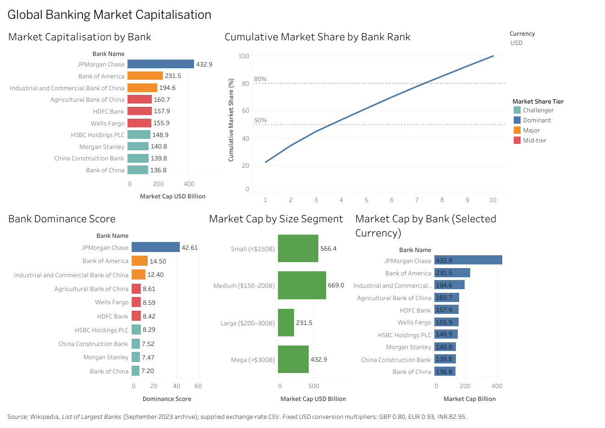

# Global Banking Market Capitalisation Analysis (PySpark)

An end-to-end ETL and exploratory-analysis project on the ten largest banks by market capitalisation in the September 2023 archived snapshot. The work covers data quality, market-capitalisation conversion, PySpark window analysis, SQLite persistence, visualisation, and a Tableau Public dashboard.

> **Scope:** this is a single historical snapshot of ten banks, not a time series or a measure of the entire banking industry. The market-share and HHI metrics describe only this top-ten group.

## Questions explored

- How concentrated is market value among the ten banks?
- How quickly does cumulative market share cross 50% and 80%?
- How large is JPMorgan Chase's lead over the next bank?
- How tight are the gaps among ranks 4–10?
- How do market-cap-based size segments compare?
- How can the USD valuation be represented in GBP, EUR and INR using the supplied fixed multipliers?

## Live Tableau Public dashboard

**[Open the interactive Global Banking Market Capitalisation dashboard](https://public.tableau.com/app/profile/ipsit1548/viz/Global_Banking_Market_Capitalisation/Dashboard1)**

The dashboard includes bank market capitalisation, cumulative share by bank rank, dominance scores, market-cap size segments, and a currency selector.



## Key findings

- **Top-ten market capitalisation:** US$1,899.82 billion.
- **Leader:** JPMorgan Chase at US$432.92 billion, or about 22.79% of the top-ten total.
- **Concentration:** CR3 is about 45.22%, CR5 about 61.99%, and the top-ten HHI about 1,203.1.
- **Cumulative share:** four banks are needed to exceed 50%; eight to exceed 80%.
- **Competitive gap:** the top four banks are separated by larger gaps; ranks 4–10 are comparatively close, so small market-cap changes can alter their order.
- **Distribution:** JPMorgan Chase is the only IQR-flagged outlier under the report's quartile method. It was retained because it is treated as a valid observation, not a data error.

Exact outputs and caveats are documented in the report.

## Project structure

```text
banking-market-capitalisation-pyspark/
├── README.md
├── requirements.txt
├── .gitignore
├── notebooks/
│   └── ETL_Bank_Data_Analysis_Ipsit_Mohanty.ipynb
├── reports/
│   └── ETL_Bank_Data_Analysis_Ipsit_Mohanty.pdf
├── assets/
│   └── tableau_dashboard.png
└── data/
    ├── source/
    │   ├── README.md
    │   └── largest_banks_2023.csv
    ├── reference/
    │   └── exchange_rates.csv
    └── processed/
        ├── Largest_banks_transformed.csv
        ├── bank_viz_data.csv
        └── bank_viz_currency_long.csv
```

## Reproduce the analysis

### 1. Environment

- Python 3.10 or 3.11 recommended
- Java compatible with Apache Spark 3.5.x
- Jupyter Notebook or JupyterLab

Create and activate a virtual environment, then install dependencies:

```powershell
python -m venv .venv
.\.venv\Scripts\Activate.ps1
python -m pip install --upgrade pip
pip install -r requirements.txt
jupyter notebook
```

Open `notebooks/ETL_Bank_Data_Analysis_Ipsit_Mohanty.ipynb`. The notebook reads the archived Wikipedia page directly. The exchange rates and the optional S&P Global rank-movement step (`Global.xlsx`, not included in this repository) are loaded from local file paths, so update those two paths in the notebook before running it. A copy of the exchange rates is in `data/reference/exchange_rates.csv`; its rate column is named `Rate_per_USD`, so rename it to `Rate` if you use it in place of the original file. The notebook writes `Banks.db`, `code_log.txt` and its CSV extracts to its working directory; copies of the processed CSVs are stored in `data/processed/`.

### 2. Dashboard files

- `data/processed/bank_viz_data.csv`: one record per bank, including market-cap conversions and derived metrics.
- `data/processed/bank_viz_currency_long.csv`: one record per bank per currency (40 rows), suitable for currency-specific charts.

The Tableau Public dashboard was built from Google Sheets copies of these CSVs. A screenshot of the dashboard is in `assets/`.

## Data and assumptions

- **Source:** [archived Wikipedia *List of largest banks* page (8 September 2023 snapshot)](https://web.archive.org/web/20230908091635/https://en.wikipedia.org/wiki/List_of_largest_banks), with a ten-row copy of the source data included in `data/source/` for reference.
- **Fields:** rank, bank name, and market capitalisation in USD billions.
- **FX multipliers:** USD = 1.00, GBP = 0.80, EUR = 0.93, INR = 82.95, applied as fixed multipliers to USD. The supplied exchange-rate file does not state its effective date, so conversions may not be contemporaneous with the market-cap snapshot.
- **Outliers:** IQR fences are based on quartiles computed from the ten values; JPMorgan Chase is flagged and retained because it is treated as a genuine observation.
- **Concentration:** share and HHI measures are computed over the top-ten subset only. Standard whole-market HHI thresholds should not be applied directly to this subset.
- **Segments and tiers:** market-share tiers, size classes, gap types, size segments, and dominance levels use analyst-defined thresholds, documented in the report and notebook.
- **Currency chart caution:** the same USD market-cap values are multiplied by different FX rates. Totals denominated in USD, GBP, EUR and INR have different numeric scales and should not be compared as if they were the same unit. A comparison across currencies requires conversion to a common currency and a documented rate date.
- **No S3 integration:** S3 was unavailable for the exercise; local CSV outputs, SQLite, and Google Sheets were used instead. Automatic dashboard refresh was not configured or verified.

## Tools

Python, PySpark, pandas, NumPy, Matplotlib, Seaborn, SQLite, Jupyter, Tableau Public, and Google Sheets.

## Report

The PDF report documents methodology, data-quality checks, nine EDA charts, ETL outputs, window-function analysis, segment analysis, dashboards, conclusions, and limitations.
